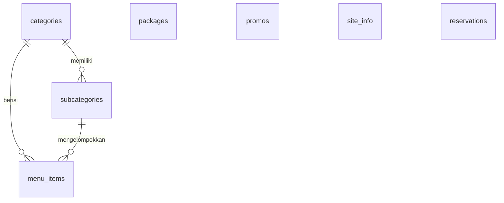

# 04 · Schema — Arunika Crumbs & Brew

> **Status:** usulan awal, diturunkan dari menu dan layanan di profil. Dialek: PostgreSQL (mudah disesuaikan ke MySQL/SQLite). Dipakai oleh `02-Architecture/02-architecture.md`. Kolom bertanda **[R2]/[R3]** baru diperlukan pada rilis tersebut (lihat `01-PRD/01-prd.md`).

## 1. Diagram relasi


## 2. DDL
```sql
CREATE TABLE categories (
  id         SERIAL PRIMARY KEY,
  nama       TEXT NOT NULL UNIQUE,      -- mis. 'Coffee-Based Drinks'
  urutan     INT  NOT NULL DEFAULT 0
);

CREATE TABLE subcategories (
  id          SERIAL PRIMARY KEY,
  category_id INT  NOT NULL REFERENCES categories(id) ON DELETE CASCADE,
  nama        TEXT NOT NULL UNIQUE,     -- mis. 'Signature Coffee'
  urutan      INT  NOT NULL DEFAULT 0
);

CREATE TABLE menu_items (
  id             SERIAL PRIMARY KEY,
  category_id    INT  NOT NULL REFERENCES categories(id),
  subcategory_id INT  REFERENCES subcategories(id),   -- NULL untuk 'Light Meals dan Camilan'
  nama           TEXT NOT NULL,
  deskripsi      TEXT NOT NULL,
  harga_idr      INT  NOT NULL CHECK (harga_idr >= 0),
  favorit        BOOLEAN NOT NULL DEFAULT FALSE,       -- penanda ★
  tersedia       BOOLEAN NOT NULL DEFAULT TRUE,        -- 'habis' bila FALSE
  alergen        TEXT[]  NOT NULL DEFAULT '{}',        -- susu, telur, gluten, kacang (belum diisi)
  foto_url       TEXT,
  urutan         INT  NOT NULL DEFAULT 0,
  UNIQUE (category_id, nama)
);

CREATE TABLE packages (
  id        SERIAL PRIMARY KEY,
  nama      TEXT NOT NULL UNIQUE,
  isi_teks  TEXT NOT NULL,                -- mis. 'Americano + Butter Croissant'
  harga_idr INT  NOT NULL CHECK (harga_idr >= 0),
  aktif     BOOLEAN NOT NULL DEFAULT TRUE,
  urutan    INT  NOT NULL DEFAULT 0
);

-- [R2] Promo wajib memuat periode, produk yang memenuhi syarat, dan batas penggunaan (profil bagian 16)
CREATE TABLE promos (
  id                SERIAL PRIMARY KEY,
  nama              TEXT NOT NULL,        -- Grand Opening, Student Deal, Coffee of the Month, ...
  deskripsi         TEXT NOT NULL,
  mulai             DATE NOT NULL,
  selesai           DATE NOT NULL,
  produk_berlaku    TEXT NOT NULL,
  batas_penggunaan  TEXT NOT NULL,
  aktif             BOOLEAN NOT NULL DEFAULT TRUE,
  CHECK (selesai >= mulai)
);

CREATE TABLE site_info (
  kunci TEXT PRIMARY KEY,
  nilai TEXT NOT NULL
);

-- [R1 sederhana / R2 penuh] Reservasi meja, acara, catering (profil bagian 12)
CREATE TYPE jenis_reservasi  AS ENUM ('meja', 'acara', 'catering');
CREATE TYPE status_reservasi AS ENUM ('menunggu', 'terkonfirmasi', 'ditolak', 'dibatalkan');

CREATE TABLE reservations (
  id               SERIAL PRIMARY KEY,
  jenis            jenis_reservasi NOT NULL,
  tanggal          DATE NOT NULL,
  waktu            TIME NOT NULL,
  jumlah_orang     INT  NOT NULL CHECK (jumlah_orang > 0),
  nama             TEXT NOT NULL,
  kontak           TEXT NOT NULL,         -- WhatsApp/telepon
  jenis_acara      TEXT,                  -- hanya acara/catering
  durasi_menit     INT,                   -- hanya acara
  kebutuhan_makan  TEXT,                  -- hanya acara/catering
  catatan          TEXT,
  status           status_reservasi NOT NULL DEFAULT 'menunggu',  -- 'terkonfirmasi' hanya oleh staf
  dibuat_pada      TIMESTAMPTZ NOT NULL DEFAULT now()
);

-- [R3] Loyalitas. Aturan poin belum ditetapkan pemilik.
CREATE TABLE members (
  id        SERIAL PRIMARY KEY,
  nama      TEXT NOT NULL,
  kontak    TEXT NOT NULL UNIQUE,
  tgl_lahir DATE,                          -- opsional, untuk Birthday Treat
  setuju_promo BOOLEAN NOT NULL DEFAULT FALSE  -- kanal yang disetujui pelanggan
);
CREATE TABLE point_ledger (
  id        SERIAL PRIMARY KEY,
  member_id INT NOT NULL REFERENCES members(id),
  poin      INT NOT NULL,                  -- positif = dapat, negatif = tukar
  keterangan TEXT,
  waktu     TIMESTAMPTZ NOT NULL DEFAULT now()
);
```

## 3. Aturan data
1. `harga_idr` disimpan sebagai bilangan bulat rupiah; tampilkan sebagai `Rp28.000`.
2. Hanya 5 baris `menu_items.favorit = TRUE` (lihat `05-Rules/05-rules.md`).
3. Setiap tampilan harga disertai `site_info.catatan_pajak`.
4. `reservations.status = 'terkonfirmasi'` hanya boleh diset oleh staf.
5. Data pelanggan (`members`) seminimal mungkin dan hanya dengan persetujuan.
6. Satu sumber data: situs membaca dari tabel ini, tidak menyalin harga ke banyak tempat.

## 4. Data awal (seed)
Hasil konversi langsung dari bagian 9 profil: 5 kategori, 10 subkategori, 60 item menu, 7 paket. Jalankan setelah DDL di atas. Nomor `whatsapp_intl` adalah format internasional untuk tautan `wa.me`; verifikasi sebelum dipakai.

```sql
-- kategori
INSERT INTO categories (nama, urutan) VALUES
  ('Coffee-Based Drinks', 1),
  ('Non-Coffee Drinks', 2),
  ('Main Course', 3),
  ('Light Meals dan Camilan', 4),
  ('Bakery dan Pastry', 5);

-- subkategori
INSERT INTO subcategories (category_id, nama, urutan) VALUES
  ((SELECT id FROM categories WHERE nama='Coffee-Based Drinks'), 'Espresso & Milk Coffee', 1),
  ((SELECT id FROM categories WHERE nama='Coffee-Based Drinks'), 'Signature Coffee', 2),
  ((SELECT id FROM categories WHERE nama='Coffee-Based Drinks'), 'Manual Brew', 3),
  ((SELECT id FROM categories WHERE nama='Non-Coffee Drinks'), 'Tea & Matcha', 4),
  ((SELECT id FROM categories WHERE nama='Non-Coffee Drinks'), 'Chocolate & Refreshers', 5),
  ((SELECT id FROM categories WHERE nama='Main Course'), 'Rice Bowl', 6),
  ((SELECT id FROM categories WHERE nama='Main Course'), 'Pasta', 7),
  ((SELECT id FROM categories WHERE nama='Main Course'), 'Western Favorites', 8),
  ((SELECT id FROM categories WHERE nama='Bakery dan Pastry'), 'Fresh Bakery', 9),
  ((SELECT id FROM categories WHERE nama='Bakery dan Pastry'), 'Cake & Dessert', 10);

-- item menu (60)
INSERT INTO menu_items (category_id, subcategory_id, nama, deskripsi, harga_idr, favorit, urutan) VALUES
  ((SELECT id FROM categories WHERE nama='Coffee-Based Drinks'), (SELECT id FROM subcategories WHERE nama='Espresso & Milk Coffee'), 'Espresso', 'Satu shot espresso pekat dengan crema tebal.', 18000, false, 1),
  ((SELECT id FROM categories WHERE nama='Coffee-Based Drinks'), (SELECT id FROM subcategories WHERE nama='Espresso & Milk Coffee'), 'Americano', 'Espresso dengan air; ringan dan bersih.', 20000, false, 2),
  ((SELECT id FROM categories WHERE nama='Coffee-Based Drinks'), (SELECT id FROM subcategories WHERE nama='Espresso & Milk Coffee'), 'Café Latte', 'Espresso dengan susu steamed yang lembut.', 25000, false, 3),
  ((SELECT id FROM categories WHERE nama='Coffee-Based Drinks'), (SELECT id FROM subcategories WHERE nama='Espresso & Milk Coffee'), 'Cappuccino', 'Espresso, susu, dan foam tebal yang seimbang.', 25000, false, 4),
  ((SELECT id FROM categories WHERE nama='Coffee-Based Drinks'), (SELECT id FROM subcategories WHERE nama='Espresso & Milk Coffee'), 'Flat White', 'Espresso dengan susu microfoam yang halus.', 27000, false, 5),
  ((SELECT id FROM categories WHERE nama='Coffee-Based Drinks'), (SELECT id FROM subcategories WHERE nama='Espresso & Milk Coffee'), 'Caramel Latte', 'Latte dengan saus karamel manis.', 29000, false, 6),
  ((SELECT id FROM categories WHERE nama='Coffee-Based Drinks'), (SELECT id FROM subcategories WHERE nama='Espresso & Milk Coffee'), 'Vanilla Latte', 'Latte dengan sirup vanila yang wangi.', 29000, false, 7),
  ((SELECT id FROM categories WHERE nama='Coffee-Based Drinks'), (SELECT id FROM subcategories WHERE nama='Espresso & Milk Coffee'), 'Hazelnut Latte', 'Latte dengan sirup hazelnut yang gurih.', 29000, false, 8),
  ((SELECT id FROM categories WHERE nama='Coffee-Based Drinks'), (SELECT id FROM subcategories WHERE nama='Signature Coffee'), 'Arunika Aren Coffee', 'Kopi susu dengan gula aren, menu andalan kami.', 28000, true, 9),
  ((SELECT id FROM categories WHERE nama='Coffee-Based Drinks'), (SELECT id FROM subcategories WHERE nama='Signature Coffee'), 'Creamy Sea Salt Latte', 'Latte dengan krim asin yang lembut.', 32000, true, 10),
  ((SELECT id FROM categories WHERE nama='Coffee-Based Drinks'), (SELECT id FROM subcategories WHERE nama='Signature Coffee'), 'Caramel Cloud Coffee', 'Kopi susu dengan topping cloud foam karamel.', 32000, false, 11),
  ((SELECT id FROM categories WHERE nama='Coffee-Based Drinks'), (SELECT id FROM subcategories WHERE nama='Signature Coffee'), 'Mocha Crumble', 'Mocha cokelat dengan taburan crumble renyah.', 33000, false, 12),
  ((SELECT id FROM categories WHERE nama='Coffee-Based Drinks'), (SELECT id FROM subcategories WHERE nama='Signature Coffee'), 'Cinnamon Honey Latte', 'Latte dengan madu dan kayu manis yang hangat.', 31000, false, 13),
  ((SELECT id FROM categories WHERE nama='Coffee-Based Drinks'), (SELECT id FROM subcategories WHERE nama='Manual Brew'), 'V60', 'Seduhan manual dengan rasa bersih dan aromatik.', 28000, false, 14),
  ((SELECT id FROM categories WHERE nama='Coffee-Based Drinks'), (SELECT id FROM subcategories WHERE nama='Manual Brew'), 'Japanese Iced Coffee', 'Diseduh panas langsung ke es; segar dan jernih.', 30000, false, 15),
  ((SELECT id FROM categories WHERE nama='Coffee-Based Drinks'), (SELECT id FROM subcategories WHERE nama='Manual Brew'), 'French Press', 'Seduhan rendam dengan body yang penuh.', 27000, false, 16),
  ((SELECT id FROM categories WHERE nama='Non-Coffee Drinks'), (SELECT id FROM subcategories WHERE nama='Tea & Matcha'), 'Classic Matcha Latte', 'Matcha dan susu; lembut dengan aroma earthy.', 28000, false, 17),
  ((SELECT id FROM categories WHERE nama='Non-Coffee Drinks'), (SELECT id FROM subcategories WHERE nama='Tea & Matcha'), 'Strawberry Matcha', 'Matcha dipadukan susu stroberi.', 32000, false, 18),
  ((SELECT id FROM categories WHERE nama='Non-Coffee Drinks'), (SELECT id FROM subcategories WHERE nama='Tea & Matcha'), 'Earl Grey Milk Tea', 'Teh earl grey beraroma bergamot dengan susu.', 25000, false, 19),
  ((SELECT id FROM categories WHERE nama='Non-Coffee Drinks'), (SELECT id FROM subcategories WHERE nama='Tea & Matcha'), 'Lemon Tea', 'Teh dengan perasan lemon yang segar.', 20000, false, 20),
  ((SELECT id FROM categories WHERE nama='Non-Coffee Drinks'), (SELECT id FROM subcategories WHERE nama='Tea & Matcha'), 'Peach Tea', 'Teh dengan rasa peach yang manis segar.', 23000, false, 21),
  ((SELECT id FROM categories WHERE nama='Non-Coffee Drinks'), (SELECT id FROM subcategories WHERE nama='Tea & Matcha'), 'Lychee Tea', 'Teh dengan sirup dan potongan leci.', 23000, false, 22),
  ((SELECT id FROM categories WHERE nama='Non-Coffee Drinks'), (SELECT id FROM subcategories WHERE nama='Chocolate & Refreshers'), 'Classic Chocolate', 'Cokelat susu klasik yang creamy.', 25000, false, 23),
  ((SELECT id FROM categories WHERE nama='Non-Coffee Drinks'), (SELECT id FROM subcategories WHERE nama='Chocolate & Refreshers'), 'Dark Chocolate', 'Cokelat pekat dengan rasa lebih intens.', 28000, false, 24),
  ((SELECT id FROM categories WHERE nama='Non-Coffee Drinks'), (SELECT id FROM subcategories WHERE nama='Chocolate & Refreshers'), 'Strawberry Milk', 'Susu segar dengan saus stroberi.', 25000, false, 25),
  ((SELECT id FROM categories WHERE nama='Non-Coffee Drinks'), (SELECT id FROM subcategories WHERE nama='Chocolate & Refreshers'), 'Mango Yakult', 'Perpaduan mangga dan Yakult yang menyegarkan.', 25000, false, 26),
  ((SELECT id FROM categories WHERE nama='Non-Coffee Drinks'), (SELECT id FROM subcategories WHERE nama='Chocolate & Refreshers'), 'Lemon Honey', 'Lemon dan madu; ringan dan segar.', 22000, false, 27),
  ((SELECT id FROM categories WHERE nama='Non-Coffee Drinks'), (SELECT id FROM subcategories WHERE nama='Chocolate & Refreshers'), 'Mineral Water', 'Air mineral kemasan.', 10000, false, 28),
  ((SELECT id FROM categories WHERE nama='Main Course'), (SELECT id FROM subcategories WHERE nama='Rice Bowl'), 'Chicken Teriyaki Bowl', 'Ayam saus teriyaki dengan nasi hangat dan sayuran.', 35000, false, 29),
  ((SELECT id FROM categories WHERE nama='Main Course'), (SELECT id FROM subcategories WHERE nama='Rice Bowl'), 'Chicken Black Pepper Bowl', 'Ayam saus lada hitam yang gurih dengan nasi.', 35000, false, 30),
  ((SELECT id FROM categories WHERE nama='Main Course'), (SELECT id FROM subcategories WHERE nama='Rice Bowl'), 'Beef Yakiniku Bowl', 'Irisan daging sapi ala yakiniku di atas nasi.', 45000, false, 31),
  ((SELECT id FROM categories WHERE nama='Main Course'), (SELECT id FROM subcategories WHERE nama='Rice Bowl'), 'Crispy Chicken Sambal Matah', 'Ayam krispi dengan sambal matah yang segar.', 38000, false, 32),
  ((SELECT id FROM categories WHERE nama='Main Course'), (SELECT id FROM subcategories WHERE nama='Rice Bowl'), 'Chicken Salted Egg Bowl', 'Ayam goreng dengan saus telur asin yang creamy.', 38000, true, 33),
  ((SELECT id FROM categories WHERE nama='Main Course'), (SELECT id FROM subcategories WHERE nama='Pasta'), 'Spaghetti Aglio Olio', 'Bawang putih, olive oil, dan cabai.', 32000, false, 34),
  ((SELECT id FROM categories WHERE nama='Main Course'), (SELECT id FROM subcategories WHERE nama='Pasta'), 'Creamy Carbonara', 'Saus krim dan keju dengan smoked beef.', 38000, false, 35),
  ((SELECT id FROM categories WHERE nama='Main Course'), (SELECT id FROM subcategories WHERE nama='Pasta'), 'Spaghetti Bolognese', 'Saus tomat dengan daging cincang.', 35000, false, 36),
  ((SELECT id FROM categories WHERE nama='Main Course'), (SELECT id FROM subcategories WHERE nama='Pasta'), 'Creamy Mushroom Pasta', 'Saus krim dengan irisan jamur.', 36000, false, 37),
  ((SELECT id FROM categories WHERE nama='Main Course'), (SELECT id FROM subcategories WHERE nama='Western Favorites'), 'Classic Chicken Burger', 'Burger ayam dengan sayuran segar dan saus spesial.', 35000, false, 38),
  ((SELECT id FROM categories WHERE nama='Main Course'), (SELECT id FROM subcategories WHERE nama='Western Favorites'), 'Beef Cheeseburger', 'Patty sapi dengan keju leleh dan sayuran.', 45000, false, 39),
  ((SELECT id FROM categories WHERE nama='Main Course'), (SELECT id FROM subcategories WHERE nama='Western Favorites'), 'Chicken Steak', 'Steak ayam dengan saus, kentang, dan sayuran.', 42000, false, 40),
  ((SELECT id FROM categories WHERE nama='Main Course'), (SELECT id FROM subcategories WHERE nama='Western Favorites'), 'French Fries', 'Kentang goreng renyah.', 22000, false, 41),
  ((SELECT id FROM categories WHERE nama='Light Meals dan Camilan'), NULL, 'Chicken Wings', 'Sayap ayam dengan saus pilihan.', 30000, false, 42),
  ((SELECT id FROM categories WHERE nama='Light Meals dan Camilan'), NULL, 'Crispy Chicken Bites', 'Potongan ayam renyah.', 28000, false, 43),
  ((SELECT id FROM categories WHERE nama='Light Meals dan Camilan'), NULL, 'Nachos Cheese', 'Keripik tortilla dengan saus keju.', 25000, false, 44),
  ((SELECT id FROM categories WHERE nama='Light Meals dan Camilan'), NULL, 'Onion Rings', 'Bawang bombai goreng berbalut tepung.', 22000, false, 45),
  ((SELECT id FROM categories WHERE nama='Light Meals dan Camilan'), NULL, 'Potato Wedges', 'Kentang berbumbu.', 23000, false, 46),
  ((SELECT id FROM categories WHERE nama='Light Meals dan Camilan'), NULL, 'Cireng Bumbu Rujak', 'Camilan khas Indonesia dengan bumbu rujak.', 20000, false, 47),
  ((SELECT id FROM categories WHERE nama='Light Meals dan Camilan'), NULL, 'Pisang Goreng Keju', 'Pisang goreng dengan topping keju.', 22000, false, 48),
  ((SELECT id FROM categories WHERE nama='Light Meals dan Camilan'), NULL, 'Mix Snack Platter', 'Kombinasi beberapa camilan untuk berbagi.', 38000, true, 49),
  ((SELECT id FROM categories WHERE nama='Bakery dan Pastry'), (SELECT id FROM subcategories WHERE nama='Fresh Bakery'), 'Butter Croissant', 'Croissant berlapis dengan aroma butter.', 20000, true, 50),
  ((SELECT id FROM categories WHERE nama='Bakery dan Pastry'), (SELECT id FROM subcategories WHERE nama='Fresh Bakery'), 'Pain au Chocolat', 'Croissant dengan isian cokelat.', 23000, false, 51),
  ((SELECT id FROM categories WHERE nama='Bakery dan Pastry'), (SELECT id FROM subcategories WHERE nama='Fresh Bakery'), 'Cinnamon Roll', 'Roti gulung kayu manis dengan glaze.', 22000, false, 52),
  ((SELECT id FROM categories WHERE nama='Bakery dan Pastry'), (SELECT id FROM subcategories WHERE nama='Fresh Bakery'), 'Cheese Danish', 'Pastry lembut dengan isian krim keju.', 23000, false, 53),
  ((SELECT id FROM categories WHERE nama='Bakery dan Pastry'), (SELECT id FROM subcategories WHERE nama='Fresh Bakery'), 'Garlic Bread', 'Roti panggang dengan butter dan bawang putih.', 18000, false, 54),
  ((SELECT id FROM categories WHERE nama='Bakery dan Pastry'), (SELECT id FROM subcategories WHERE nama='Fresh Bakery'), 'Egg & Cheese Sandwich', 'Roti isi telur dan keju, disajikan hangat.', 28000, false, 55),
  ((SELECT id FROM categories WHERE nama='Bakery dan Pastry'), (SELECT id FROM subcategories WHERE nama='Cake & Dessert'), 'Chocolate Fudge Cake', 'Kue cokelat lembap dengan fudge.', 28000, false, 56),
  ((SELECT id FROM categories WHERE nama='Bakery dan Pastry'), (SELECT id FROM subcategories WHERE nama='Cake & Dessert'), 'Classic Cheesecake', 'Cheesecake lembut dengan dasar biskuit.', 30000, false, 57),
  ((SELECT id FROM categories WHERE nama='Bakery dan Pastry'), (SELECT id FROM subcategories WHERE nama='Cake & Dessert'), 'Tiramisu', 'Dessert berlapis dengan rasa kopi dan krim mascarpone.', 30000, false, 58),
  ((SELECT id FROM categories WHERE nama='Bakery dan Pastry'), (SELECT id FROM subcategories WHERE nama='Cake & Dessert'), 'Red Velvet Cake', 'Kue red velvet dengan cream cheese frosting.', 28000, false, 59),
  ((SELECT id FROM categories WHERE nama='Bakery dan Pastry'), (SELECT id FROM subcategories WHERE nama='Cake & Dessert'), 'Brownies', 'Brownies cokelat yang padat dan fudgy.', 20000, false, 60);

-- paket (7)
INSERT INTO packages (nama, isi_teks, harga_idr, urutan) VALUES
  ('Morning Starter', 'Americano + Butter Croissant', 35000, 1),
  ('Arunika Breakfast', 'Egg & Cheese Sandwich + Café Latte', 45000, 2),
  ('Student Combo', 'Rice Bowl + Lemon Tea', 45000, 3),
  ('Coffee Break', 'Cappuccino + Brownies', 40000, 4),
  ('Sweet Afternoon', 'Matcha Latte + Croissant', 43000, 5),
  ('Sharing Platter', 'Mix Snack Platter + 2 Lemon Tea', 65000, 6),
  ('Couple Treat', '2 minuman pilihan + 2 pastry', 85000, 7);

-- info situs
INSERT INTO site_info (kunci, nilai) VALUES
  ('nama', 'Arunika Crumbs & Brew'),
  ('slogan', 'Coffee, Comfort, and Little Moments.'),
  ('alamat', 'Ruko Promenade, Jl. Dr. Ir. H. Soekarno, Kedung Baruk, Rungkut, Surabaya, Jawa Timur'),
  ('telepon_whatsapp', '0851 7547 4311'),
  ('whatsapp_intl', '6285175474311'),
  ('instagram', '@arunika.crumbs'),
  ('tiktok', '@arunika.crumbs'),
  ('jam_buka', 'Setiap hari (Senin–Minggu), 08.00–22.00 WIB'),
  ('catatan_pajak', 'Harga belum termasuk pajak sesuai ketentuan yang berlaku.'),
  ('catatan_alergen', 'Informasi alergen (susu, telur, gluten, kacang) dapat ditanyakan langsung kepada staf.');
```
